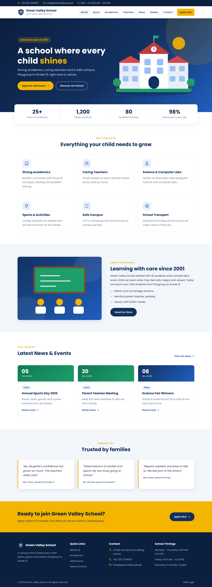

# Green Valley School Website

A school website built with **PHP**, **MySQL** and **CSS** (no frameworks, no JavaScript).
It runs on **XAMPP** and you edit it in **Visual Studio**.



## What it has

**Public website**
- Home: hero banner, numbers, features, about, latest news, parent quotes
- About Us, Academics, Teachers, News & Events, Gallery
- Admissions form (saved in the database)
- Contact form (saved in the database)
- Works on phones, with a burger menu made with CSS only

**Admin area** (`/admin`)
- Login and logout (password stored safely with `password_hash`)
- Dashboard with totals
- Admissions list with status (New, Contacted, Accepted, Rejected)
- Contact messages (read and delete)
- News & Events (add, edit, delete)

## Folder structure

```
school-website/
├── app/                     <- PHP code (not opened directly in the browser)
│   ├── config.php           <- database login and school details. Edit here first.
│   ├── bootstrap.php        <- every page loads this first
│   ├── helpers.php          <- small functions: e(), url(), redirect(), icon()...
│   ├── classes/             <- one class per table (OOP)
│   │   ├── Database.php     <- opens the PDO connection
│   │   ├── Auth.php         <- admin login / logout
│   │   ├── Admission.php    <- admissions table
│   │   ├── ContactMessage.php <- messages table
│   │   ├── News.php         <- news table
│   │   └── Teacher.php      <- teachers table
│   └── views/               <- parts used on many pages
│       ├── header.php, footer.php, page-hero.php, news-card.php
│       └── admin-header.php, admin-footer.php
├── public/                  <- pages you open in the browser
│   ├── index.php, about.php, academics.php, teachers.php
│   ├── news.php, news-view.php, gallery.php
│   ├── admissions.php, contact.php
│   ├── admin/               <- login.php, index.php, admissions.php, messages.php, news.php, news-form.php, logout.php
│   └── assets/
│       ├── css/style.css    <- all website design
│       ├── css/admin.css    <- admin design
│       └── img/             <- logo and pictures (SVG)
├── database/school.sql      <- creates the database, tables and sample data
├── docs/screenshots/        <- pictures of every page
├── .editorconfig            <- formatting rules (4 spaces, UTF-8)
├── .gitignore               <- files Git should not upload
└── README.md                <- this file
```

**How a page works (example: contact.php)**
1. `require bootstrap.php` loads config, helpers and classes.
2. If the form was sent (`POST`), the page calls `ContactMessage::validate()`, then `ContactMessage::create()`.
3. After saving it redirects back to itself, so refreshing does not send the form twice.
4. Then it prints `header.php`, the page HTML, and `footer.php`.

---

## Step 1: Put the project in XAMPP

1. Unzip the project so the folder is **`C:\xampp\htdocs\school-website`**.
2. Open the **XAMPP Control Panel** and click **Start** for **Apache** and **MySQL**.

## Step 2: Create the database

1. Open **http://localhost/phpmyadmin**.
2. Click the **Import** tab at the top.
3. Click **Choose File** and pick `C:\xampp\htdocs\school-website\database\school.sql`.
4. Click **Import** at the bottom. A new database called `school_website` appears on the left.

If your MySQL has a password, put it in `app/config.php` on the `DB_PASS` line.

## Step 3: Open the website

- Website: **http://localhost/school-website/public/**
- Admin: **http://localhost/school-website/public/admin/login.php**
  - Username: `admin`
  - Password: `admin123`

If you used a different folder name, change `BASE_URL` in `app/config.php`.

## Step 4: Open it in Visual Studio

1. Open **Visual Studio 2026**.
2. On the start screen click **Open a local folder** (or **File > Open > Folder**).
3. Choose `C:\xampp\htdocs\school-website` and click **Select Folder**.
4. All files appear in **Solution Explorer** on the right. Double-click a file to edit it.
5. Save with **Ctrl + S**, then refresh the browser to see the change.

Visual Studio reads `.editorconfig` by itself, so every file uses the same formatting (4 spaces).
To tidy a file, press **Ctrl + K** then **Ctrl + D**.

---

## Step 5: Put it on GitHub

**A. Create an empty repository on GitHub**
1. Go to **https://github.com/new** (logged in as `shehbazkhan436`).
2. Repository name: `school-website`.
3. Choose **Public** (to show in your portfolio).
4. Do **not** tick "Add a README" (we already have one).
5. Click **Create repository**.

**B. Upload the code (Command Prompt)**

Open **Command Prompt** and run these lines **one by one** (press Enter after each):

```
cd C:\xampp\htdocs\school-website
git init
git add .
git commit -m "First version of the school website"
git branch -M main
git remote add origin https://github.com/shehbazkhan436/school-website.git
git push -u origin main
```

On the last command a browser window opens. Click **Sign in with your browser**, log in to GitHub
and click **Authorize**. Then refresh your GitHub page and your code is there.

**C. After every change (the daily routine)**

```
git add .
git commit -m "Say what you changed, for example: Add fees page"
git push
```

You can also do this inside Visual Studio: open **View > Git Changes**, type a message,
click **Commit All**, then click the **Push** arrow (↑).

---

## Common changes: where to edit

| I want to change...              | Edit this file                         |
|----------------------------------|----------------------------------------|
| School name, phone, email        | `app/config.php`                       |
| Colours of the whole site        | `public/assets/css/style.css` (top, `:root`) |
| Menu links                       | `app/views/header.php`                 |
| Footer text and timings          | `app/views/footer.php`                 |
| Home page sections               | `public/index.php`                     |
| Academic programs                | `public/academics.php` (`$programs` list) |
| Gallery pictures                 | `public/gallery.php` (`$photos` list) + `public/assets/img/` |
| Teachers                         | `teachers` table in phpMyAdmin         |
| News and events                  | Admin > News & Events                  |
| Admin password                   | see below                              |

**Change the admin password**
1. Make a file `public/hash.php` with: `<?php echo password_hash('MyNewPassword', PASSWORD_DEFAULT);`
2. Open `http://localhost/school-website/public/hash.php` and copy the long text.
3. In phpMyAdmin, open the `admins` table, edit the `admin` row, and paste it into `password`.
4. **Delete `hash.php`** afterwards.

## Ideas for next steps
- Add a Fees page that reads a `fees` table
- Let the admin add and edit teachers (like News)
- Upload real photos for the gallery from the admin area
- Send an email to the office when a new admission comes in
- Add CSRF tokens to the forms (extra security)
